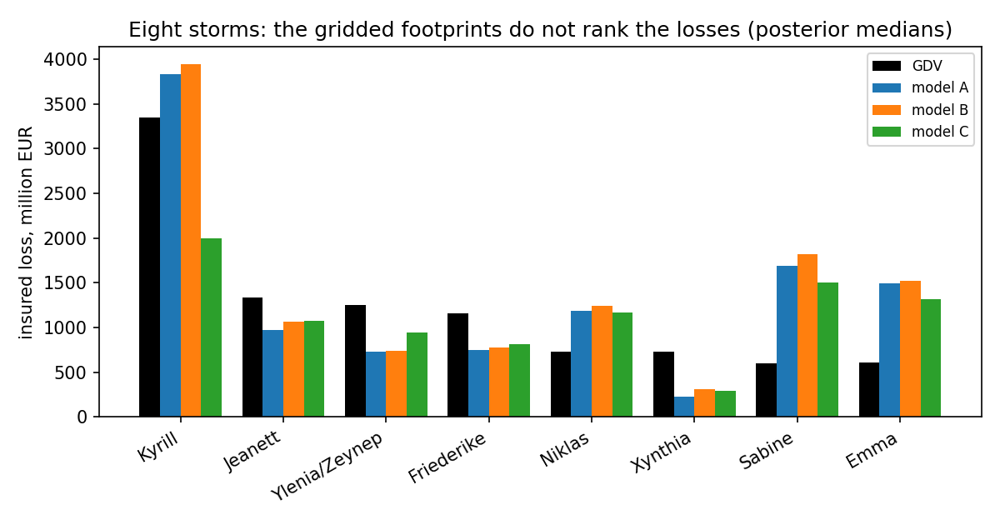
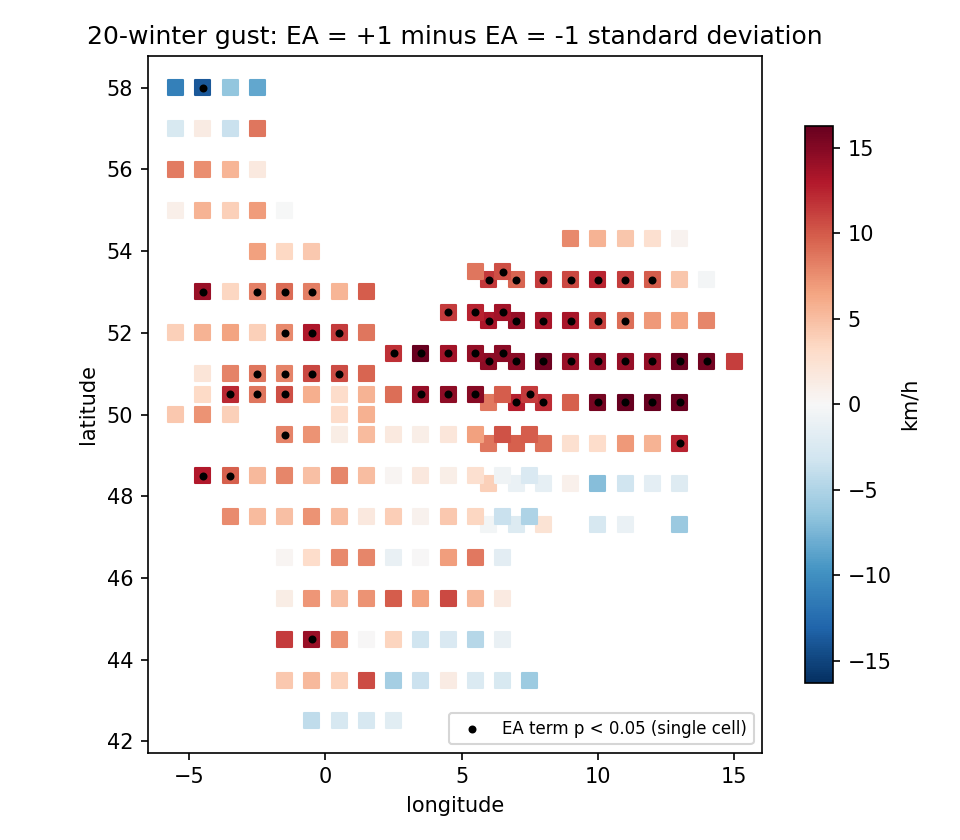
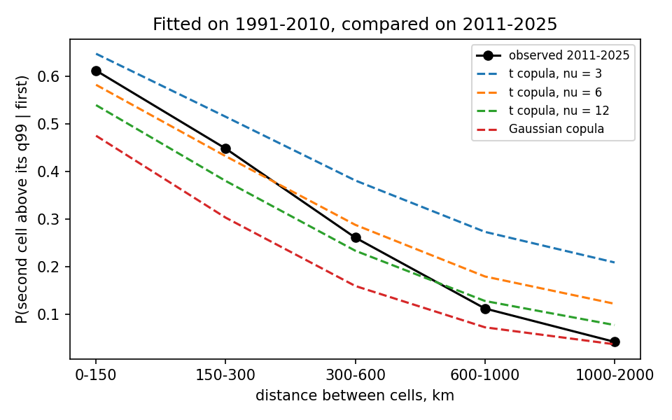

# Windstorm and compound wind-rain uncertainty over Western Europe

Where does the uncertainty of a rare winter windstorm loss come from when the hazard is taken from a gridded reanalysis? The study covers Germany, France, Belgium, the Netherlands and Great Britain for the winters (October to March) of 1991 to 2025: storm events and their clustering, extreme gusts that depend on the North Atlantic Oscillation (NAO) and the East Atlantic pattern (EA), compound wind and rain, a stochastic event set, three loss models weighted against eight insured storm losses, and the EA and the Atlantic overturning (AMOC) in 12 CMIP6 models.

It is a self-directed research study on public data. It is not a catastrophe model, not a loss estimate for any insurer or market, and it has not been reviewed by others.

It follows [unrisk-windstorm-uq](https://github.com/serikov-climate-risk/unrisk-windstorm-uq) (German stations, emulation and history matching) and [de-windstorm-risk](https://github.com/serikov-climate-risk/de-windstorm-risk) (station loss index and GDV calibration).

## Main findings

1. **Gridded footprints on this 1 degree sample cannot reproduce the eight storm losses.** None of the three loss models fits them better than one constant loss for all storms (root mean square error of the log loss: constant 0.54, models A, B and C 0.56 to 0.66 with a fixed error and 0.61 to 0.71 with an inferred error). With the inferred error Sabine and Emma come out more than twice too high and Xynthia at less than half.
2. **An assumed error size hides this.** With the error fixed at 0.29 (log scale) the 90% ranges of the 1-in-200 annual German loss are narrow (for example 4.0 to 5.6 bn EUR for model A). When the error is inferred together with the parameters it comes out at 0.72 to 0.81 (medians) and the same range for model A is 3.2 to 9.4 bn EUR.
3. **The East Atlantic pattern matters regionally.** The 20-winter gust is higher in positive than in negative EA winters by a median of 14 km/h in Belgium, 12 in the Netherlands, 10 in Germany, 6 in Great Britain and 4 in France. The EA term is significant at 5% in 29% of cells, but only 40 of 209 cells survive a false discovery rate of 10%.
4. **No overdispersion of large events between winters** is detected in this domain (variance to mean ratio 0.84, 34 winters), while exceedance days do cluster within storm spells (extremal index 0.56 at the 95th percentile).
5. **Wind and rain extremes coincide** 5.6 to 7.4 times more often than if they were independent.
6. **No detectable link between AMOC weakening and the EA shift** across 10 CMIP6 models (Spearman 0.32, p = 0.37); the mean EA change is small against the spread between models.



## Data

| Source | Use |
|---|---|
| ERA5 through the [Open-Meteo historical weather API](https://open-meteo.com/) (CC BY 4.0), daily gust maximum and rain sum, 1991-2025, 284 points | hazard; 209 points fall in the five countries (FR 84, DE 58, GB 50, NL 11, BE 6) |
| [NOAA CPC teleconnection indices](https://ftp.cpc.ncep.noaa.gov/wd52dg/data/indices/tele_index.nh), monthly NAO and EA (`data/cpc_tele_index.nh.txt`) | covariates |
| ERA5 December-February sea level pressure EOFs 1951-2025 (`data/era5_djf_eof_reference.npz`, built in unrisk-windstorm-uq; EOF1 correlates 0.89 with the CPC NAO, EOF2 0.72 with the CPC EA) | one NAO and EA definition for CMIP6 |
| GDV insured property losses of eight storms (portfolio and prices of 2020, status February 2022, two entries preliminary), as [reprinted by a trade publication](https://dev.wohnungswirtschaft-heute.de/wp-content/uploads/2022/04/Winterstuerme-Versicherungsschaeden-14-Mrd-Euro-GDV.pdf) (`data/gdv_storm_losses.csv`) | loss model evidence |
| CMIP6 from the Pangeo cloud archive, member r1i1p1f1, historical and SSP5-8.5: sea level pressure and meridional overturning streamfunction | EA, NAO and AMOC change |
| Natural Earth 1:110m countries | assignment of points to countries |

**Provenance of the ERA5 series.** For the run reported here, 1991-2016 were taken from the API's default request and 2017-2025 from requests with `models=era5`. The default request must not be used for the later years: from 2017 it returns a different model (daily gust maxima differ from ERA5 on 97% of point-days, by 4.3 km/h on average). Because of the daily API limit, 2017-2025 of 37 of the 209 points were read from the same archive's [open data on AWS](https://github.com/open-meteo/open-data), in the grid cell that reproduces the API series of 2016. The two routes give identical daily values for 29 other points over 2017-2025, and the 1991-2016 series equals the AWS ERA5 copy for 12 points over all 26 years. `scripts/download_data.py` requests ERA5 explicitly for all years.

Contains modified Copernicus Climate Change Service information.

## Method

**Events.** Each cell gets the index max(0, gust / q98 - 1) squared with its own winter 98th percentile. An event is a run of days on which the mean over all cells exceeds its 95th percentile.

**Clustering.** Dispersion of the number of large events (top 20%) per winter against a Poisson bootstrap, runs estimator of the extremal index and inter-arrival times.

**Circulation.** Poisson regression of monthly exceedance days per country on NAO and EA (HAC errors) and, per cell, a generalised Pareto model of declustered gust exceedances whose log scale depends on both indices (likelihood ratio tests, Benjamini-Hochberg correction).

**Compound extremes.** Frequency of gust above q98 together with rain above q95 relative to independence, bootstrap over winters.

**Stochastic event set.** Per cell margins (empirical with a generalised Pareto tail), a t copula with exponential distance decay of the correlation and an AR(1) from day to day. The chi-square mixing variable has its own AR(1). Degrees of freedom (6) and mixing persistence (0.6) were chosen from a grid, with 1,000 simulated winters per pair, to match the observed number of events per winter and the spread of the winter loss index; the event set used afterwards has 3,000 winters.

**Loss models and importance resampling.** On the German cells: A relative gust threshold, B absolute threshold in m/s, C as A with capped damage. Observed storms use the largest gust within one day of the storm date, simulated events the largest gust over the event days. 100,000 parameter draws per model are weighted by a Gaussian likelihood on log losses with the scale integrated out, either with a fixed error (observation 15% and model 25%, assumptions) or with the error drawn log-uniformly between 0.15 and 1.5 and weighted by the same data.

**CMIP6.** December-February sea level pressure of each model is interpolated to the ERA5 grid and projected on the ERA5 patterns after removing the model's own 1985-2014 mean; changes are 2071-2100 in ERA5 standard deviations. AMOC strength is the maximum over depth at 26.5N.

## Results

### Events and clustering

209 events in the record (6.0 per complete winter). 11 of 16 well-known storms are among the 25 largest by summed index (Lothar 1st, Kyrill 2nd, Sabine 3rd); Gudrun (42nd) and Ciaran (48th) rank low in this domain mean. Large events per winter: mean 1.24, variance to mean 0.84 (p = 0.74 against Poisson). Extremal index 0.56 at q95 and 0.81 at q99; the coefficient of variation of inter-arrival times is 1.00.

### NAO and EA

Rate ratio of monthly exceedance days per standard deviation:

| Country | NAO | EA |
|---|---|---|
| Belgium | 1.51 | 1.37 |
| Germany | 1.52 | 1.09 (t = 0.9) |
| France | 1.10 (t = 1.3) | 1.24 |
| Great Britain | 1.64 | 1.28 |
| Netherlands | 1.58 | 1.21 |
| All cells | 1.46 | 1.25 |

In the cell models the median shape parameter is -0.23; NAO is significant at 5% in 29% of cells (33 after the 10% false discovery rate), EA in 29% (40).



### Compound wind and rain

| Country | Same day, ratio to independence (90% bootstrap) | Rain on the day before |
|---|---|---|
| Belgium | 6.3 (5.8-7.2) | 2.9 |
| Germany | 7.1 (6.6-7.7) | 3.5 |
| France | 7.2 (6.7-7.8) | 3.3 |
| Great Britain | 5.6 (5.2-6.0) | 2.8 |
| Netherlands | 7.4 (6.6-8.1) | 2.6 |

### Does the event set look like the record?

| | Observed | Simulated |
|---|---|---|
| Events per winter | 6.00 | 6.27 |
| Days per event | 1.53 | 1.39 |
| Winter index, all cells: standard deviation ratio | 1 | 1.03 |
| Winter index, all cells: 98th percentile | 0.24 | 0.27 |

The number of events per winter and the spread of the winter index were used to choose the two parameters, so their agreement is a fit and not a test. By country the spread ratio is 0.90 (France) to 1.18 (Great Britain).

The spatial tail was checked with a fit on 1991-2010 against 2011-2025 (mean absolute error of the conditional joint exceedance of q99 over five distance classes: 0.044 for both 6 and 12 degrees of freedom, 0.086 for a Gaussian copula and 0.110 for 3). With 6 degrees of freedom joint extremes at short range are close to the record, but beyond 600 km they are too frequent (0.12 against 0.04 at 1000-2000 km).



Without persistence of the mixing variable (12 degrees of freedom) the simulator splits storms into 8.3 events per winter and the spread of the winter index is 25% too small.

### 1-in-200 annual German loss, bn EUR (median and 5-95% over parameter draws)

| Model | Fixed error | Inferred error | Inferred error, event set without persistence | Log error of storm fit (fixed / inferred) |
|---|---|---|---|---|
| A relative threshold | 4.7 (4.0-5.6) | 5.3 (3.2-9.4) | 4.7 (2.9-8.4) | 0.66 / 0.71 |
| B absolute threshold | 4.9 (4.2-5.9) | 5.8 (3.9-11.9) | 5.0 (3.5-10.7) | 0.61 / 0.67 |
| C capped damage | 6.1 (4.4-7.9) | 4.7 (2.9-7.7) | 4.4 (2.7-7.4) | 0.56 / 0.61 |
| One constant for all storms | | | | 0.54 |

Model C comes closest to the constant: with the fixed error its posterior gives most of the eight storms a similar loss, so it fits better without telling storms apart. The ranges describe parameter uncertainty given each model and one event set. The prior ranges span factors of about 700 to 2,100, so the eight losses mainly fix the scale; they do not validate the shape of any model.

### CMIP6, 2071-2100 against 1985-2014, SSP5-8.5

| | Mean over models | Range | Models with an increase |
|---|---|---|---|
| EA index, ERA5 standard deviations (12 models) | -0.05 | -0.60 to 0.52 | 4 of 12 |
| NAO index (12 models) | 0.18 | -0.11 to 0.43 | 9 of 12 |
| AMOC strength (10 models) | -38% | -53% to -22% | 0 of 10 |

Across the 10 models neither the EA shift (Spearman 0.32, p = 0.37) nor the NAO shift (0.19, p = 0.60) is related to the AMOC change. Ten models with one member each can only detect a strong relation.

## Limitations

- The hazard is a point sample: one ERA5-based value per point at about 1 degree spacing, daily maxima, no population or exposure weights. The grid is the union of four boxes with different offsets, so overlapping areas are sampled more densely and weigh more in country means. Reanalysis gusts miss local extremes; this is a likely reason for the poor storm fit, which was not tested.
- Countries come from coarse 1:110m outlines with a 0.35 degree margin at the coast.
- Eight storm losses are few, partly preliminary and quoted from a reprint.
- The event set has no link to NAO or EA, no seasonal cycle within the winter and no trend. It is a statistical emulator, not a max-stable process.
- The cell models change only the scale with NAO and EA, not the event rate, and give no intervals for the return level differences.
- Rain enters only the compound statistics; there is no rain damage function.
- CMIP6, not CMIP7; one member per model; EA from sea level pressure, which is related to but not the same as the CPC rotated 500 hPa pattern.

## Reproduce

```
pip install -e ".[test,cmip6]"
python scripts/download_data.py        # rate limited, may need more than one run
python scripts/run_all.py              # about 15 minutes
python scripts/download_cmip6.py       # about 170 MB
python scripts/run_cmip6_ea_amoc.py
python scripts/make_figures.py
pytest
```

| Path | Content |
|---|---|
| `src/stormeu/` | events, clustering, extreme value models, compound statistics, copula, resampling |
| `scripts/` | data download, analyses, figures |
| `results/` | all numbers quoted above |
| `tests/` | 13 tests on synthetic data |
